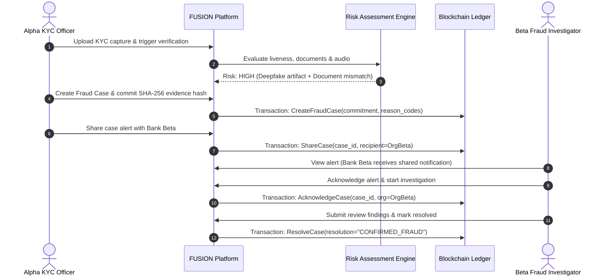

# Project FUSION: Permissioned Blockchain for Cross-Bank Deepfake & KYC Fraud Management

> **Note on Blockchain Execution**: This prototype is configured with a built-in **Permissioned Blockchain Simulator** that faithfully implements Hyperledger Fabric's data structures, append-only transactions, state machine transitions, and endorsement logic without requiring a local Fabric peer daemon. A production-ready **Hyperledger Fabric Go Chaincode** contract is included in [`blockchain/chaincode/fusion.go`](file:///d:/fusion_blockchain/blockchain/chaincode/fusion.go).

---

## 1. System Overview

FUSION is a consortium blockchain platform enabling multiple financial institutions (**Bank Alpha**, **Bank Beta**, **Bank Gamma**) to coordinate investigations into AI-generated deepfakes, synthetic identities, document tampering, and coordinated KYC fraud—**without centralizing or exposing raw customer PII**.

### Key Architecture Principles
- **Zero Customer PII On-Chain**: Only opaque case identifiers, SHA-256 evidence commitments, reason codes, and organization MSP IDs are recorded on the ledger.
- **Append-Only Auditing**: Case updates, corrections, and reviews are recorded as sequential tamper-evident events.
- **Explainable Risk Scoring**: Deterministic, rule-driven evaluation providing human-readable explanations and explicit reason codes. Missing detectors default fail-safely to `INDETERMINATE`.
- **No Automated Blacklisting**: AI outputs are strictly decision-support aids; all punitive actions require dual human review.



---

## 2. Quickstart & Running the Project

### Prerequisites
- **Python**: 3.10+
- **Node.js**: 18+ (tested on Node v20/v24)
- **PowerShell / Terminal**

### Option A: Run Locally (Fastest)

#### 1. Backend Server
```powershell
# In project root (d:\fusion_blockchain)
pip install -r requirements.txt
uvicorn backend.app.main:app --reload --host 127.0.0.1 --port 8000
```
- API will be accessible at: `http://127.0.0.1:8000`
- Interactive OpenAPI Docs: `http://127.0.0.1:8000/docs`

#### 2. Frontend Application
```powershell
# In frontend directory (d:\fusion_blockchain\frontend)
cd frontend
npm install
npm run dev
```
- Web Application will be live at: `http://localhost:5173`

---

## 3. Demo Credentials & Organizations

| Organization | Username | Password | Role | Responsibilities |
|---|---|---|---|---|
| **Bank Alpha** | `alpha.officer` | `alpha.officer!123!` | `BANK_KYC_OFFICER` | Ingests KYC, creates cases, commits evidence |
| **Bank Alpha** | `alpha.admin` | `alpha.admin!123!` | `SYSTEM_ADMIN` | Configures consortium access & node status |
| **Bank Beta** | `beta.investigator`| `beta.investigator!123!`| `BANK_FRAUD_INVESTIGATOR` | Receives shared cases, investigates, resolves |
| **Bank Beta** | `beta.auditor` | `beta.auditor!123!` | `REGULATOR_AUDITOR` | Read-only ledger audit & compliance review |
| **Bank Gamma** | `gamma.auditor` | `gamma.auditor!123!` | `REGULATOR_AUDITOR` | Independent oversight, cross-org auditing |

*(The login screen includes 1-click Quick-Switch buttons for instant role testing).*

---

## 4. Running the Automated Test Suite

A comprehensive test suite of 40 unit and integration tests verifies authentication, RBAC, KYC verification sessions, deterministic risk scoring, case lifecycle state machines, evidence hash integrity, and blockchain transactions:

```powershell
# From project root
python -m pytest backend/tests/test_api.py -v
```

---

## 5. Hyperledger Fabric Production Deployment

The project includes production-ready Fabric artifacts:
- **Chaincode**: [`blockchain/chaincode/fusion.go`](file:///d:/fusion_blockchain/blockchain/chaincode/fusion.go) (Go 1.20+)
- **Network Reference**: [`blockchain/network/docker-compose-fabric.yml`](file:///d:/fusion_blockchain/blockchain/network/docker-compose-fabric.yml)

To test the Go chaincode locally:
```bash
cd blockchain/chaincode
go test -v ./...
```
